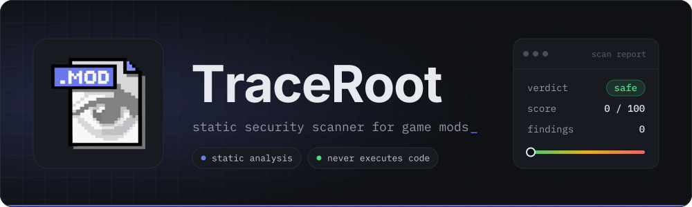
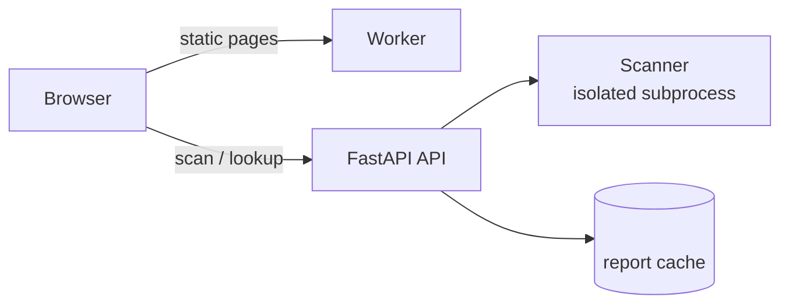

  

  
  
  

  Check a game mod for malware before you run it. 
  Upload a file, paste a Modrinth link, or look up a hash and get a plain-language report.

---

## What it does

TraceRoot inspects a mod's bytecode and metadata **without ever executing it**, then returns a risk level (`safe`, `caution`, `risky`, `malicious`), a 0-100 score, and the individual findings behind it. Every scan gets a shareable report page at `/report/<sha256>`.

It currently supports Minecraft `.jar` mods and plugins. Other formats (Call of Duty `.gsc` scripts, for one) are planned.

## Features

- **Three ways to scan:** upload a `.jar` (up to 50 MB), paste a Modrinth URL, or look up an existing report by SHA-256 / SHA-1.
- **Static analysis only:** the file is parsed, never run. Untrusted archives are bounded against zip bombs and runaway nesting.
- **Real-world detections:** remote class loading, write-then-execute, credential and wallet targeting, paste-site and raw C2 URLs, clipboard hijacking, unsafe deserialization, jar self-propagation, zip-slip, hardcoded credentials, disabled TLS validation, and high-entropy payloads.
- **Looks inside bundled jars:** nested jars are scanned too, and well-known libraries are recognized to cut down on false alarms.
- **Loader detection:** Fabric, Forge, NeoForge, and Paper / Spigot / Bukkit.
- **Cached, shareable reports** and a public mod directory indexed from Modrinth.

## How it fits together

## Limitations

Static analysis flags suspicious behavior; it can't prove a file is safe, and heuristics can produce false positives and misses. Treat a `safe` result as a good sign, not a guarantee, and only download mods from sources you trust.

TraceRoot is an independent project and isn't affiliated with Mojang, Microsoft, or Modrinth.

## Contributing

Issues and pull requests are welcome. Please run `npm run lint` before opening a PR.

## License

[MIT](LICENSE) © 2026 v7upSln
